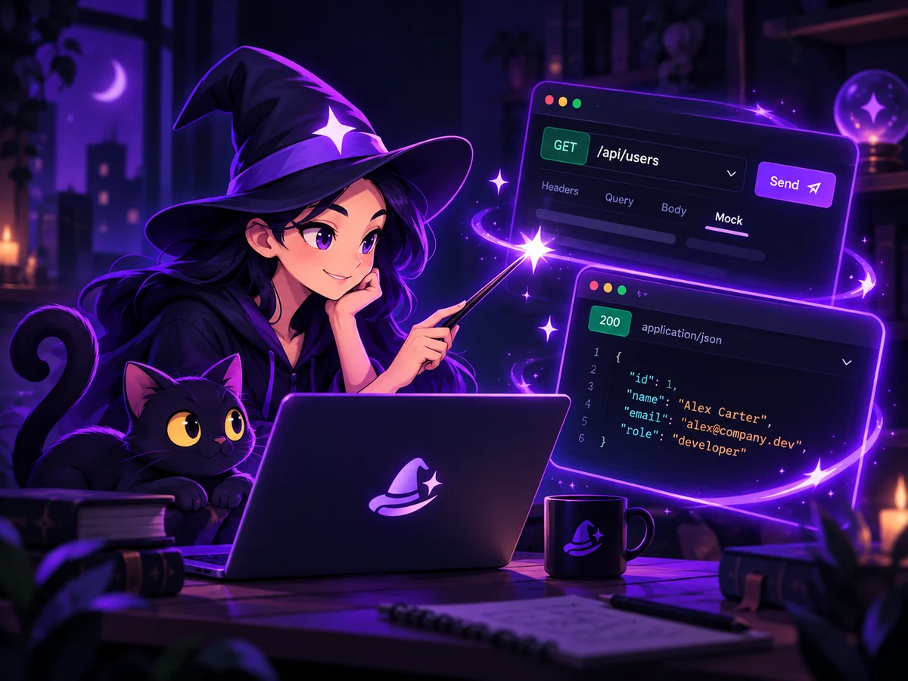
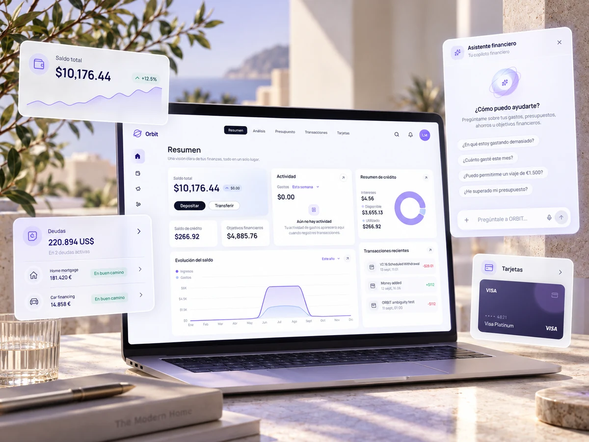
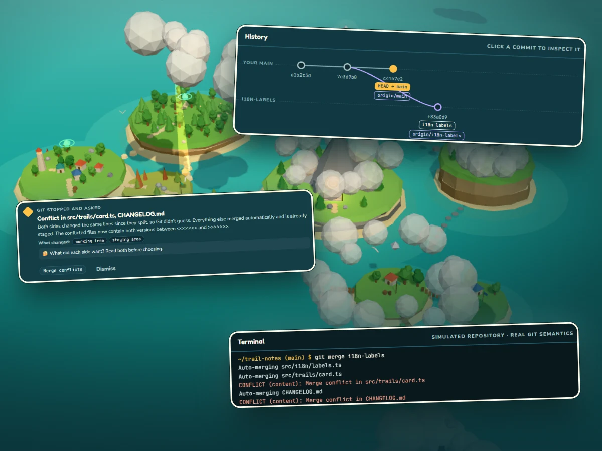

# lacosta.dev

**Frontend Developer · React & TypeScript**

My personal portfolio: the independent products I'm building, my professional experience, and how I approach complex production frontend applications.

### [Visit the live portfolio →](https://www.lacosta.dev/)

## About me

I specialize in React and TypeScript, working on enterprise and financial applications where interfaces and business logic can get complex. My focus is on reusable components, design systems, and API integrations that make those interfaces easier to use and maintain.

I care about accessibility, frontend performance, and maintainable, well-tested code—not just getting a feature out the door.

## Featured projects

Four independent products, from a published developer tool and an open-source learning game to platforms still taking shape.

| Mockadabra                                                                                                                                                | ORBIT Finance                                                                                         | Ani Studio                                                                                                       | GitLands |
| :-------------------------------------------------------------------------------------------------------------------------------------------------------- | :---------------------------------------------------------------------------------------------------- | :--------------------------------------------------------------------------------------------------------------- | :-- |
|                                                  |  |  |  |
| A Chrome extension for mocking and modifying API requests, with rules, projects, environments, variables, and advanced request matching.                  | A personal finance application for accounts, transactions, budgets, analytics, and financial goals.   | A creative commerce and learning platform for handmade products, personalized creations, and online courses.     | A 3D adventure game that teaches Git through real incidents, a simulated terminal and a live commit graph. |
| **Published on the Chrome Web Store**                                                                                                                     | **In development**                                                                                    | **In development**                                                                                               | **Playable, open source** |
| [Website](https://mockadabra.com/) · [Add to Chrome](https://chromewebstore.google.com/detail/mockadabra-api-mocking-re/jchfebdkfiognkefhfpmiimancglfiid) | Private build; no public link yet.                                                                    | [Coming-soon website](https://anistudio.store/)                                                                  | [Play it](https://gitlands-adventure.vercel.app/) |

## Inside the portfolio

- Interactive project showcase using the **View Transitions API**, with a fallback for unsupported browsers.
- A **Git graph-inspired timeline** of my professional experience.
- Responsive layouts with light and dark themes.
- Accessible interactions and subtle animations that respect reduced-motion preferences.
- A contact form integrated with **Resend**.

## Tech stack

- **Foundation:** Next.js 16 (App Router), React 19, TypeScript.
- **Presentation:** Sass / SCSS, Next Font, Lucide React.
- **Integrations:** Resend, Vercel Analytics.

## Running locally

You'll need **Node.js 20.9+** and **pnpm**.

```bash
pnpm install
pnpm dev
```

Open [localhost:3000](http://localhost:3000).

To enable contact-form email delivery, optionally create `.env.local`:

```env
RESEND_API_KEY=re_your_key_here
CONTACT_FROM_EMAIL="Website contact <onboarding@resend.dev>"
```

Keep this file private. Use a sender on a Resend-verified domain for production email.

## Contact

[Portfolio](https://www.lacosta.dev/) · [GitHub](https://github.com/lacosta) · [LinkedIn](https://www.linkedin.com/in/lacostadev/)
